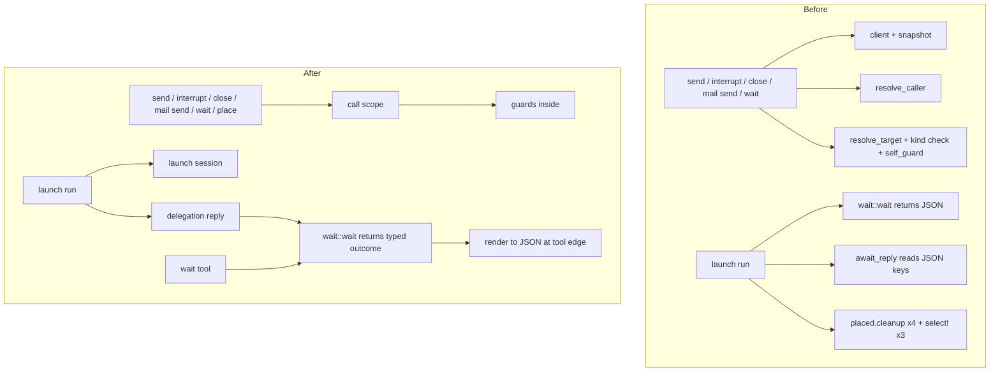
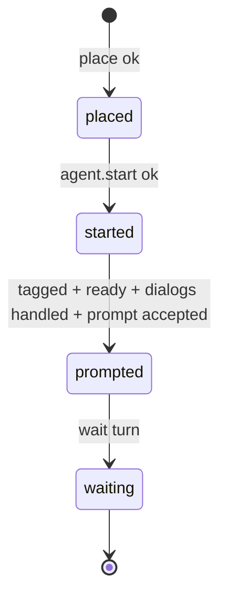

# Tool Layer Deepening - Plan

## Goal Capsule

- **Objective:** deepen four shallow seams in the MCP tool layer (call scope, typed wait results, delegation reply, launch session) without changing anything a client sees.
- **Authority:** this plan, then `AGENTS.md` and `CLAUDE.md` (repo email, `github-personal` remote, `-j 4` test runs), then existing code conventions.
- **Stop conditions:** stop and ask if a unit would change a tool's wire output, an error code, or which panes a failure cleans up; or if a tool-level test needs its assertions changed to pass.
- **Execution profile:** serial units in U-ID order; each unit lands as one local commit on `main` with the offline suite green.
- **Tail ownership:** local commits only. Push, live tests against a real Herdr, and plugin updates stay with the user.

---

## Product Contract

### Summary

Refactor the tool layer so the caller-and-target resolution, the wait result, the reply-by-mail wait and the launch pane lifecycle each live behind one module with a small interface. Tool behaviour on the wire stays identical.

### Problem Frame

The architecture review of 2026-10-21 found the tool layer wide but shallow.
Every targeted tool rebuilds the same client, snapshot, caller, target, kind check and self-guard sequence, so the "never target your own pane" rule holds only because each tool remembers to call it.
`wait::wait` returns wire JSON, and launch reads its own output back through string keys such as `"matched"` and `"status"`, so a renamed field breaks the reply logic without a compile error.
The reply-by-mail wait (about 210 lines) is buried in `src/tools/launch.rs`, where the coming task tools cannot reuse it.
Launch decides keep-or-clean-up per failure branch, with four hand-written `placed.cleanup` calls and three `select!` cancellation blocks, each building its own phase details.

### Requirements

**Call scope**

- R1. One module resolves the caller and the target for every targeted tool; the self-guard runs inside it, so no tool calls `guard::self_guard` directly.
- R2. The module expresses which target kinds a tool accepts, and the provenance guard, as part of the request rather than as code in each tool.

**Typed wait results**

- R3. `wait::wait` returns a typed outcome; JSON is rendered only at the tool edge.
- R4. Launch and the delegation reply read wait outcomes through typed fields, never through string keys.

**Delegation reply**

- R5. The reply-by-mail plan, the reply instruction, taking the reply, and the combined mail-and-turn wait live in their own module that launch calls and future task tools can reuse.

**Launch session**

- R6. A launch session owns the pane a call placed: it tracks the phase, attaches phase details to failures, and decides cleanup by one rule table.
- R7. `herdr_launch` and `herdr_run` both use the session; no `placed.cleanup` call remains outside it and `place`.

**Behaviour preservation**

- R8. Every tool's wire output, error codes, error details and cleanup behaviour stay the same; the tool-level tests pass with unchanged assertions.

### Scope Boundaries

- No new tools, parameters or response fields.
- Tools outside launch, wait and the reply path keep building their JSON directly; typed results stop at those internals.
- `herdr_list`, `herdr_capabilities` and `herdr_read` keep their own caller resolution; they resolve no guarded target, and `herdr_read` may read the caller's own pane.

#### Deferred to Follow-Up Work

- Moving child MCP injection out of launch (`injection`, `bridge_binary`) into its own module (review candidate 4).
- One adapter per agent kind across `providers`, `runtime_mode` and the installer (review candidate 6); revisit when a third kind lands.
- Splitting `src/tools/launch.rs` further (startup, dialogs) once the session and reply have moved out.
- Collapsing `Tuning`, `LaunchTuning` and `interrupt_settle` into one timing struct.

---

## Planning Contract

### Key Technical Decisions

- KTD1. **Scope review candidates 1, 2, 3 and 5; leave 4 and 6.** (session-settled: user-directed — chosen over all six candidates: the user picked 1, 2, 3 and 5 from the architecture review.)
- KTD2. **Wire behaviour is frozen.** The tool-level tests are the safety net and keep their assertions: `tests/tools_*.rs`, `tests/mcp_server.rs`, and the harness-driven `herdr_wait` cases in `tests/wait.rs` (`the_tool_*`, `an_unverified_caller_*`, `progress_notifications_*`, `client_cancel_*`). Only the `tests/wait.rs` cases that call `wait::wait` directly may change how they read the result, and they must still check the same values.
- KTD3. **The call scope resolves the caller up front and fetches the snapshot only when the request needs one.** Today's socket calls and error precedence stay per path: send, interrupt, close, mail send and wait's target path keep `tokio::try_join!` of snapshot and caller; wait's turn-plus-target path keeps `tokio::join!` with the caller error reported first; wait's turn-only path and `herdr_run` take no snapshot; `place`'s existing-pane path fetches its one snapshot when it runs.
- KTD4. **Kind check before self-guard, except `herdr_wait`.** Send, interrupt, close and mail send check the kind first. `herdr_wait` keeps the self-guard first, because `tests/wait.rs` `the_tool_refuses_the_callers_own_pane` asserts `self_target` for a tab holding the caller's pane. Changing that order would be a wire change for a separate plan.
- KTD10. **Two entry points, not one flag per tool.** One target request covers send, interrupt, close, mail send and wait's target path: accepted kinds with the refusal's error code and message, `allow_self`, `force`, tolerant unknown names, and wait's guard order. A small "guard this known pane for this caller" entry covers wait's turn path and `place`'s existing-pane path. A kind refusal carries its own code: the tools use `unsupported_target`, `place` uses `invalid_params`.
- KTD5. **Mail send's tolerant target stays a scope option.** `herdr_mail_send` accepts an unknown name that does not look like a Herdr ID (it goes to a name inbox), so the scope offers an optional-target resolution instead of always failing with `target_not_found`.
- KTD6. **The typed wait outcome keeps the three result shapes.** Shared fields are `matched`, `timed_out`, `pane` and `note`. Agent waits add `status`, both seqs, `excerpt`, optional `superseded`, and `turn` only when a turn settles blocked or times out. Output waits add `excerpt`. Process waits add `pgid` and optional `result: no_active_work`, with no excerpt. One render function produces today's JSON for each.
- KTD7. **Notes become a list joined at render.** The `"; "`-joined note string is built in exactly one place, so the order notes are added in today must be the order they are pushed.
- KTD8. **The launch session encodes today's keep-or-clean-up table, not a new rule.** The table under High-Level Technical Design is the contract; the session exposes "fail and clean up" and "fail and keep", and each call site picks per that table.
- KTD9. **Phase details follow today's two converters.** On the wait path, `detailed()` attaches details to `Tool` errors and passes `Api` errors through untouched. On the prompt path, `prompt_error` turns `AgentBlocked` into `agent_blocked` (phase `started`) and `AgentPromptStalled` into `agent_prompt_stalled` (phase `prompted`), and passes other errors through without details. A raw socket error from `agent_send_keys` during dialogs still surfaces without details.

### High-Level Technical Design

Module shape before and after. Arrows are calls.

Launch phases, and what each failure does to the pane this call placed. This is today's behaviour, which U5 must reproduce.

| Phase | Failure | Pane | Phase in details |
|---|---|---|---|
| before place | validation, `name_taken`, reply-mail refusal, runtime escalation | nothing created | none |
| placed | injection error | cleaned up | none |
| placed | `agent.start` error | cleaned up | none |
| placed | client cancels | kept | `placed` |
| started | provenance tag fails | cleaned up | `started` (`provenance_failed`) |
| started | `agent_get` error while waiting for ready | cleaned up | none |
| started | blocked during startup (`agent_not_ready`) | kept | `started` |
| started | shell back in front (`agent_exited`) | cleaned up | `started` + `cleaned_up` |
| started | ready timeout (`agent_not_ready`) | kept | `started` |
| started | client cancels | kept | `started` |
| started | dialog surfaced or stuck (`agent_needs_input`) | kept | `started` + `dialog` |
| started | `agent_send_keys` socket error in dialogs | kept | none |
| prompted | prompt refused while blocked (`agent_blocked`) | kept | `started` |
| prompted | prompt stalled (`agent_prompt_stalled`) | kept | `prompted` |
| prompted | any other prompt error | kept | none |
| waiting | wait error | kept | `waiting` (+ `turn`) |
| waiting | client cancels | kept | `waiting` (+ `turn`, mail `rewait`) |

`herdr_run` uses the same session with these rows:

| Step | Failure | Pane | Details |
|---|---|---|---|
| after place | typing the command fails | cleaned up | none |
| after send | readiness read error or observer client error | kept | none |

### Assumptions

- `place::place` keeps cleaning up its own provenance-tag failure; the session takes over only once `place` returns.
- `resolve_caller` keeps taking its own snapshot on the fallback path. The scope does not try to share that snapshot, since that would change how often the socket is called.

### Open Questions

- Deferred: type names inside the new modules are the implementer's call. File paths in the units are binding.

---

## Implementation Units

### U1. Call scope module

- **Goal:** one module that opens a client, resolves the caller and snapshot, and hands out guarded targets.
- **Requirements:** R1, R2, R8; KTD3, KTD4, KTD5, KTD10.
- **Dependencies:** none.
- **Files:** create `src/scope.rs`; modify `src/lib.rs`; test `tests/scope.rs`.
- **Approach:** build from `Inner` (client, caller env, ancestry). Offer the two entry points from KTD10, each with the snapshot behaviour KTD3 gives its callers. Return the caller resolution, the snapshot when one was taken, and the agent in the target pane. Move `resolve_target`, `self_guard` and `provenance_guard` behind it; `guard.rs` either folds in or keeps only its pure `resolve`.
- **Patterns to follow:** the current sequence in `src/tools/send.rs` and `src/tools/close.rs`; error constructors in `src/herdr/error.rs`; `FakeHerdr` scripting in `tests/support/fake_herdr.rs` and helpers in `tests/support/harness.rs`.
- **Test scenarios:**
  - A pane ID target resolves to that pane, with its agent when one runs there.
  - An agent name resolves to its pane; a name missing from the snapshot falls back to Herdr's `agent.get` alias lookup.
  - A target naming the verified caller's pane is refused with `self_target`; with `allow_self` it resolves.
  - An unverified caller still guards the env-named pane (`HERDR_PANE_ID`).
  - A tab that contains the caller's pane is refused for self-targeting.
  - A tab target for a pane-only request is refused with the request's code and message: `unsupported_target` for a tool, `invalid_params` for `place`.
  - With the self-guard-first order, a tab holding the caller's pane returns `self_target`; with kind-first order it returns `unsupported_target`.
  - The known-pane entry with a target name reports a caller error before a snapshot error when both fail.
  - The known-pane entry with no target name takes no snapshot (the fake Herdr scripts none).
  - The provenance guard refuses a target with a pane no bridge launched, listing those panes; `force` lets it through.
  - An unknown non-ID name with the tolerant option returns no target; an unknown pane-ID-shaped string still fails with `target_not_found`.
  - A Herdr that is not running surfaces `NotRunning` from the scope, as today.
- **Verification:** `tests/scope.rs` passes; nothing calls the scope yet, so the other suites are untouched.

### U2. Migrate targeted tools to the call scope

- **Goal:** every targeted tool resolves through the scope; the guard calls disappear from the tools.
- **Requirements:** R1, R2, R8; KTD2, KTD3, KTD4, KTD5, KTD10.
- **Dependencies:** U1.
- **Files:** modify `src/tools/send.rs`, `src/tools/interrupt.rs`, `src/tools/close.rs`, `src/tools/mail.rs`, `src/tools/wait.rs`, `src/tools/launch.rs`, `src/tools/run.rs`, `src/place.rs`, `src/guard.rs`; tests unchanged: `tests/tools_launch_send.rs`, `tests/tools_interrupt.rs`, `tests/tools_run_close.rs`, `tests/tools_list_read.rs`, `tests/mailbox.rs`, `tests/mcp_server.rs`, and the harness-driven cases in `tests/wait.rs`.
- **Approach:** replace each tool's client, snapshot, caller and guard prelude with the matching scope entry from KTD10. Wait's turn path and `place`'s existing-pane path use the known-pane entry, keeping KTD3's snapshot and precedence per path. Launch takes the snapshot and caller from the scope; run takes only the caller.
- **Execution note:** migrate one tool per step and run that tool's test file before the next; the existing tests are the characterization.
- **Patterns to follow:** U1's interface; keep each tool's `unsupported_target` message text exactly.
- **Test scenarios:**
  - Test expectation: the existing tool-level suites pass with unchanged assertions. No new behaviour; the scope's own coverage is in U1.
  - Add one test only if a migrated path turns out uncovered, for example `where.pane` naming the caller's own pane in `herdr_run`.
- **Verification:** `rg 'self_guard\(|resolve_target\(' src/tools src/place.rs` finds nothing; the full offline suite is green.

### U3. Typed wait outcome

- **Goal:** `wait::wait` returns a typed outcome; the wait tool and launch render it to today's JSON.
- **Requirements:** R3, R4, R8; KTD2, KTD6, KTD7.
- **Dependencies:** U2 (both touch `src/tools/wait.rs`).
- **Files:** modify `src/wait.rs`, `src/tools/wait.rs`, `src/tools/launch.rs`; test `tests/wait.rs`.
- **Approach:** model the shared fields plus a per-condition detail (agent status and seqs with optional `superseded` and `turn`; output excerpt; process `pgid` and `no_active_work`). Notes are a list. A render function emits exactly today's keys, including absent-versus-null choices. The wait tool appends its cap note before rendering. Launch merges the rendered fields as it does now until U4 replaces that path.
- **Execution note:** before changing types, capture today's JSON for one representative case of each condition in `tests/wait.rs`, and keep those assertions passing through the render function.
- **Patterns to follow:** `Verdict` and `Turn` in `src/turn.rs` for typed results; `agent_result` in `src/wait.rs` for the current field set.
- **Test scenarios:**
  - A turn that settles done renders `matched`, `timed_out`, `pane`, `status`, both seqs and `excerpt`, with no `turn` key.
  - A turn that settles blocked, or times out, also renders `turn`.
  - An `until` status wait renders the excerpt like a turn wait.
  - A superseded turn renders `superseded: true`.
  - A settled `unknown` status renders the unknown note.
  - An output match renders the excerpt; an output timeout renders the tail with `timed_out: true`.
  - A process wait with no active work renders `result: "no_active_work"` with `matched: false` and `timed_out: false`.
  - A wait capped by the profile carries the cap note after any wait note, joined with `"; "`.
  - Through the MCP surface, `herdr_wait` output is unchanged (existing `tests/wait.rs` tool-level cases).
- **Verification:** no `serde_json::Value` in `wait::wait`'s signature; `tests/wait.rs` and the launch suite are green.

### U4. Delegation reply module

- **Goal:** move the reply-by-mail plan and wait out of launch into a module with a typed result.
- **Requirements:** R4, R5, R8; KTD2.
- **Dependencies:** U3.
- **Files:** create `src/delegation.rs`; modify `src/tools/launch.rs`, `src/lib.rs`; test `tests/delegation.rs`; unchanged `tests/tools_launch_send.rs` mail cases.
- **Approach:** move `MailPlan`, `mail_plan`, `reply_paragraph`, `take_reply`, `await_reply` and `running_fields`. `mail_plan` takes the injection check as an input (a "child gets the mail tool" flag) so the module does not depend on launch's injection code. Launch computes that flag only for reply mail and only after the verified-caller check; screen launches still call `injection()` after place. The mail poll and reply grace are passed in, so the module does not depend on `LaunchTuning`. `await_reply` reads the typed wait outcome and returns a typed reply outcome: reply received, settled without mail, timed out with a rewait, or ended for another status. Each outcome keeps today's field sources: mail mid-turn uses the current status fields; mail found after a wait timeout keeps the timed-out result (with its `turn`) flipped to matched; a cap that runs out during the grace keeps the settled fields with `matched: false`. Launch renders that outcome into its response.
- **Patterns to follow:** the current `await_reply` loop; `wait_for_mail` in `src/tools/mail.rs` for poll-with-cancel shape.
- **Test scenarios:**
  - Mail from the child arriving mid-turn returns the reply with the current status and no excerpt.
  - A turn that settles without mail waits the grace, then returns no reply with the "finished without mailing" note and the excerpt.
  - Mail arriving inside the grace is still the reply.
  - A turn wait that times out with mail already waiting returns the reply as matched.
  - A wait cap that runs out returns a timeout with a `rewait` naming the child.
  - A blocked or working-again turn returns no reply and leaves the decision to the caller.
  - Cancellation returns the cancelled error with the mail `rewait` in its details.
  - Only the child's mail is consumed; other senders' mail stays unread.
  - The plan refuses an unverified caller, and a child without the mail tool, before anything is created.
- **Verification:** the launch mail tests in `tests/tools_launch_send.rs` pass unchanged; no string-key reads of wait fields remain (`rg 'get\("matched"\)|get\("timed_out"\)' src`).

### U5. Launch session

- **Goal:** one owner for the placed pane's phase, failure details, cleanup and cancellation, used by launch and run.
- **Requirements:** R6, R7, R8; KTD8, KTD9.
- **Dependencies:** U4.
- **Files:** create `src/tools/launch_session.rs`; modify `src/tools/launch.rs`, `src/tools/run.rs`, `src/tools/mod.rs`; tests `tests/tools_launch_send.rs`, `tests/tools_run_close.rs`.
- **Approach:** the session holds the client, the placed pane, the agent name and the current phase. It offers: advance phase; fail and clean up; fail and keep with phase details (tool errors only, per KTD9); and race a future against cancellation with the phase's message. `await_ready`'s `NotReady { cleanup }` maps onto the two failure exits. Phase details stay `progress()`'s exact fields.
- **Execution note:** first add tool-level characterization tests for each row of the keep-or-clean-up tables that no test covers today (likely `agent.start` failure, provenance tag failure, `agent_get` error while waiting for ready, and the dialog `agent_send_keys` socket error); then move the code. The injection-error row cannot be triggered through the fake Herdr (`bridge_binary` only fails if `current_exe` fails), so cover it with a session-level test of the "fail and clean up" exit.
- **Patterns to follow:** `assert_no_cleanup` and the cancel tests in `tests/tools_launch_send.rs`; `Placed::cleanup` in `src/place.rs`.
- **Test scenarios:**
  - Each row of the keep-or-clean-up table: the pane is closed or kept as listed, and `phase` in the details matches.
  - A stalled prompt returns `agent_prompt_stalled` with phase `prompted`; any other prompt error passes through without details.
  - `agent_exited` reports `cleaned_up: true` only when this call created the pane; a launch into an existing pane cleans nothing.
  - Cancelling before start, during readiness and during the wait each keeps the pane and reports its phase.
  - A socket error from `agent_send_keys` during dialogs surfaces without details and keeps the pane.
  - `herdr_run`: a failure typing the command closes the tab it created; a run into an existing pane closes nothing.
- **Verification:** `rg 'placed.cleanup' src/tools` matches only inside the session; the launch and run suites are green.

---

## Verification Contract

| Gate | Command | When |
|---|---|---|
| Format | `cargo fmt --check` | every unit |
| Lint | `cargo clippy --all-targets -- -D warnings` | every unit |
| Targeted tests | `cargo test -j 4 --test <file> -- --test-threads 4` for the unit's test files | during each unit |
| Offline suite | `cargo test -j 4 -- --test-threads 4` | before each unit's commit |
| Live suite | `tests/live` against a real Herdr | not run by agents; the user runs it if wanted |

The machine is shared: keep `-j 4` and `--test-threads 4`, and check `memory_pressure | tail -1` before a full run.

---

## Definition of Done

- All five units are committed locally on `main`, one commit each, with the offline suite, format and clippy green at each commit.
- Tool-level test assertions in `tests/tools_*.rs`, `tests/mcp_server.rs` and the harness-driven `herdr_wait` cases in `tests/wait.rs` are unchanged; only additions.
- No tool in `src/tools` calls `self_guard`, `resolve_target` or `placed.cleanup` directly.
- `wait::wait` and the delegation reply return typed outcomes; JSON is built at the tool edge.
- No abandoned-attempt code, unused helpers or `#[allow(dead_code)]` remain from the refactor.
- Nothing is pushed; the user decides when to push.

| Unit | Done when |
|---|---|
| U1 | `tests/scope.rs` covers every scenario above and passes |
| U2 | targeted tools use the scope; existing suites pass unchanged |
| U3 | wait returns a typed outcome; rendered JSON matches today's |
| U4 | reply logic lives in its own module with typed results; launch mail tests unchanged |
| U5 | every keep-or-clean-up row is covered by a tool-level test, or a session-level test for the injection row, and handled by the session |

---

## Appendix

### Sources

- Architecture review, 2026-10-21 (this session): candidates 1 (call scope), 2 (launch session), 3 (typed wait), 5 (delegation reply).
- Current prelude pattern: `src/tools/send.rs` `run`, `src/tools/interrupt.rs` `run`, `src/tools/close.rs` `run`, `src/tools/mail.rs` `send`, `src/tools/wait.rs` `run`, `src/place.rs` `existing`.
- Wait result shapes: `src/wait.rs` `agent_result`, `wait_for_output`, `wait_for_process`.
- Reply path: `src/tools/launch.rs` `mail_plan`, `await_reply`, `take_reply`, `running_fields`.
- Cleanup and phase handling: `src/tools/launch.rs` `run`, `await_ready`, `handle_dialogs`, `progress`, `detailed`; `src/place.rs` `Placed::cleanup`.
- No `docs/solutions/`, `CONCEPTS.md` or ADRs exist in the repo; no external research was needed for an internal refactor.
