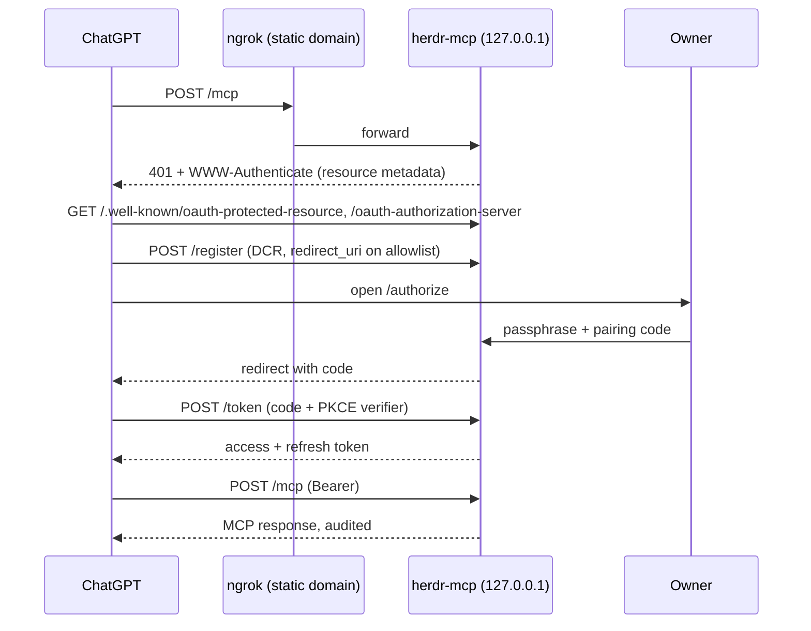

# Ngrok Remote With Login - Plan

## Goal Capsule

- **Objective:** ChatGPT reaches herdr-mcp over a stable ngrok URL, and only after the owner logs in with OAuth. The read and full modes, the background service, the audit log and the kill switches all match the OpenAI-tunnel path.
- **Authority:** this plan, then `AGENTS.md` and the user's global instructions.
- **Stop conditions:**
  - stop and ask before any change that serves MCP without a valid token;
  - stop before any change that accepts a redirect URI outside the allowlist;
  - stop before any change that stores a secret in plain text.
- **Tail ownership:** local commits. The user claims the ngrok domain, connects ChatGPT and decides on push.

---

## Product Contract

### Summary

Add `herdr-mcp tunnel ngrok setup|start|stop|status|pair|revoke`. herdr-mcp serves Streamable HTTP MCP on localhost and is its own OAuth authorization server. ngrok forwards the owner's free static domain to it. Connecting ChatGPT means passing a login page that asks for the owner's passphrase and a one-time pairing code.

### Problem Frame

The OpenAI tunnel is blocked until the ChatGPT workspace is linked to the Platform org. The hand-run ngrok bridge works, but its only protection is a secret path, so full mode over it is a remote shell behind a URL. Every restart also changes the URL.

### Requirements

**Transport**
- R1. herdr-mcp serves MCP over Streamable HTTP on `127.0.0.1` at `/mcp`, through rmcp's server transport, with no Node bridge.
- R2. One bridge state (the active session, the audit log and expiry) is shared by every MCP session in the process.

**Login (OAuth 2.1)**
- R3. Without a valid bearer token, `/mcp` returns `401` with `WWW-Authenticate` pointing at the protected-resource metadata.
- R4. The server publishes protected-resource metadata (RFC 9728) and authorization-server metadata (RFC 8414). It supports dynamic client registration (RFC 7591), and authorization code with PKCE S256 only.
- R5. The login page needs both the owner passphrase and a valid one-time pairing code.
- R6. Redirect URIs must match an allowlist; the default is `https://chatgpt.com/connector/oauth/*`.
- R7. Tokens are opaque random values, stored only as hashes. Access tokens last 1 h; refresh tokens last 30 d and rotate. `tunnel ngrok revoke` invalidates every token and client.
- R8. Failed logins are rate-limited.

**Service and ngrok**
- R9. `tunnel ngrok setup`:
  - stores the static domain (plain config);
  - stores the passphrase verifier, never the passphrase itself;
  - checks that ngrok and its authtoken are present.
- R10. `tunnel ngrok start [--full] [--for]`:
  - runs a LaunchAgent that binds a free localhost port, then starts `ngrok http --url https://<domain> 127.0.0.1:<port>`;
  - prints a fresh pairing code;
  - for `--full`, requires the typed disclosure.
- R11. `stop`, `status` and `pair` (a new code, valid 10 minutes) manage it. `doctor` covers it.
- R12. The audit log, `herdr_tunnel_stop`, `--for` expiry and the remote instructions behave as they do on the OpenAI-tunnel path.

### Scope Boundaries

- No ngrok paid features: no ngrok OAuth, and no IP policy.
- The OpenAI-tunnel commands stay as they are.
- Linux background service is out of scope; `ngrok run` works in the foreground.
- Shorter prompts in the audit log is a separate item, #6.

---

## Planning Contract

### Key Technical Decisions

- KTD1. **The owner logs in with a passphrase plus a pairing code.** (session-settled: user-directed — chosen over passphrase only or pairing code only: the user picked both.)
- KTD2. **Use a free ngrok static domain, so the plugin URL stays fixed.** (session-settled: user-directed — chosen over a random URL per start.)
- KTD3. **Native rmcp `transport-streamable-http-server` on axum, replacing `supergateway`.** One process holds both the auth check and MCP, with no Node at runtime.
- KTD4. **herdr-mcp is its own authorization server.** ChatGPT connects server to server and supports MCP OAuth with DCR and PKCE; ngrok's browser-session OAuth cannot serve it.
- KTD5. **The passphrase verifier is an Argon2id hash in the Keychain**, under service `herdr-mcp-ngrok` and account `passphrase`. Pairing codes, clients and token hashes go in a 0600 JSON store in the state dir.
- KTD6. **Bind localhost only, and start ngrok after the listener is bound in the same process.** The port is ours by construction, which closes the wrong-server failure seen in testing.
- KTD7. **The redirect URI allowlist defaults to ChatGPT's connector callback.** A client that registers itself cannot get a code sent anywhere else.

### High-Level Technical Design

---

## Implementation Units

### U1. Streamable HTTP MCP behind an auth hook

- **Goal:** a hidden `herdr-mcp http-serve --bind 127.0.0.1:<port> --tools read|control [--tunnel ...]` command that serves rmcp Streamable HTTP at `/mcp`, with a tower layer that asks a `TokenCheck` trait for every request.
- **Files:**
  - `Cargo.toml`: rmcp features, plus axum and tower;
  - `src/http.rs` (new), `src/cli.rs`, `src/main.rs`, `src/server.rs`;
  - test: `tests/http.rs`.
- **Test scenarios:**
  - a request with no token gets `401` and the `WWW-Authenticate` header;
  - with an allow-all `TokenCheck`, `initialize`, then `tools/list`, then `herdr_list` (FakeHerdr) works over HTTP;
  - two MCP sessions share the active session;
  - audit lines are written in tunnel mode;
  - the server binds 127.0.0.1 only.

### U2. OAuth authorization server

- **Goal:** metadata, `/register`, `/authorize` (a login page asking for passphrase and pairing code), `/token` (authorization code with PKCE S256, refresh with rotation), a token store, and revoke.
- **Files:** `src/oauth.rs` (new; plus `src/oauth/*` if large), `src/http.rs`; test: `tests/oauth.rs`.
- **Test scenarios:**
  - **Happy path:** register, authorize with the correct passphrase and code, exchange the code with a matching PKCE verifier, receive a token, and then `/mcp` returns `200`.
  - **Wrong credentials:** a wrong passphrase, or a wrong or expired code, gets no code. Five failures lock login for 15 minutes.
  - **Bad PKCE:** the `plain` method is refused, and so is a mismatched verifier.
  - **Bad redirect:** a `redirect_uri` off the allowlist is refused at register and at authorize.
  - **Replay:** a code is single-use, and an expired access token gets `401`.
  - **Refresh:** a refresh token rotates; the old one becomes invalid.
  - **Revoke:** revoke clears every token and client.
  - **Storage:** tokens are stored only as hashes, and the store file is 0600.

### U3. `tunnel ngrok` service commands

- **Goal:** `setup`, `start [--full] [--for] [--session]`, `run` (what the agent runs), `stop`, `status`, `pair` and `revoke`, plus `doctor` checks, plugin actions and the README.
- **Files:** `src/tunnel.rs` or `src/tunnel/ngrok.rs` (new), `src/cli.rs`, `src/main.rs`, `herdr-plugin.toml`, `README.md`; tests: `tests/tunnel_ngrok.rs`, `tests/manifest.rs`.
- **Test scenarios** (fake `ngrok`, `launchctl` and `security`):
  - setup stores the domain and verifier, and rejects a bad domain;
  - start writes the plist (a separate label, `dev.herdr-mcp.ngrok`) and prints a pairing code;
  - `--full` needs the typed phrase;
  - `run` binds first, then spawns ngrok with `--url`;
  - stop and status;
  - pair issues a new code;
  - revoke empties the store;
  - doctor reports ngrok, the authtoken, the domain and the service.

### U4. Install and verify live

- **Goal:** the full suite passes, the plugin is updated, the user claims the domain and runs setup, then start, then connects ChatGPT with the login, and a read and a write action each succeed and are audited.

---

## Verification Contract

| Gate | Command |
|---|---|
| Format | `cargo fmt --check` |
| Lint | `cargo clippy -j 4 --all-targets -- -D warnings` |
| Tests | `cargo test -j 4 -- --test-threads 4` (check `memory_pressure` first) |

## Definition of Done

- U1–U3 are committed with the suite green. No test touches the real Keychain, LaunchAgents, state dir or a real socket.
- A live ChatGPT connection over the static domain works only after login.
- `revoke` cuts ChatGPT off.
